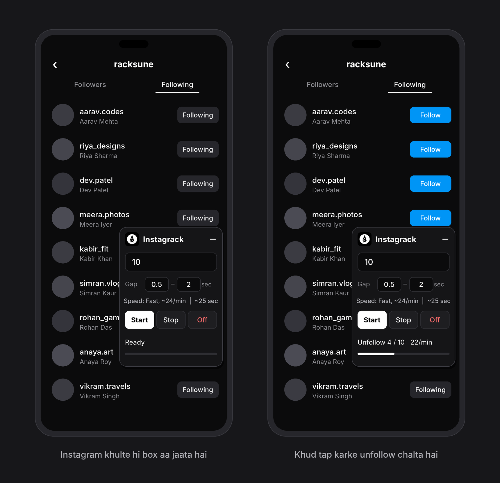

# Instagrack

Instagram ki Following list se unfollow karne wala Android app. Instagram ke upar ek chhota floating box aata hai, usme number aur gap (seconds) likho, Start dabao, baaki app khud karta hai.



## APK kaise milega (GitHub se)

1. Ye repo apne GitHub account pe push karo (branch `main`).
2. **Actions** tab kholo, "Build APK" run complete hone do (3-5 min).
3. Run kholo, neeche **Artifacts** se `Instagrack-apk` download karo (zip ke andar `Instagrack.apk`).

Seedha **Releases** page se download karna ho to tag push karo:

```
git tag v1.0
git push origin v1.0
```

Phir Releases mein `Instagrack.apk` mil jaayega.

## Phone mein install aur setup

1. APK install karo ("Unknown sources" allow karna padega).
2. **Android 13+ par:** Settings > Apps > Instagrack > upar teen dot (⋮) > **Allow restricted settings**. Iske bina Accessibility ON nahi hota (option grey rehta hai).
3. Settings > Accessibility > **Instagrack** ON karo.
4. Instagrack icon dabao. Instagram khulega aur side mein box aayega.
5. Box mein number, gap (jaise `0.5` aur `2` seconds) likho, **Start** dabao.

## Box ke buttons

| Button | Kaam |
| --- | --- |
| Start | Unfollow shuru |
| Stop | Rok do (box rehta hai) |
| Off | Box band |
| `–` | Box ko chhota bubble banao (bubble dabao to wapas) |

Header pakad ke box ko kahin bhi drag kar sakte ho. Box mein speed (kitne unfollow per minute) aur live speed dikhti hai.

## Dhyan rakho

- Gap bahut kam rakhoge to Instagram "Action Blocked" laga sakta hai. Block dikhte hi app khud ruk jaata hai.
- Screen on rakho aur Instagram ko foreground mein chalne do.
- Instagram apna UI badalta rehta hai. Agar button ke naam badle to `UnfollowService.kt` mein `"Following"`, `"Unfollow"`, `"Profile"` wale labels update karne padenge.
- Ye Instagram ke rules ke against hai, apne risk pe use karo.

## Local build

Android Studio mein folder kholo aur Run dabao, ya `gradle assembleDebug` (Gradle 8.9, JDK 17).
